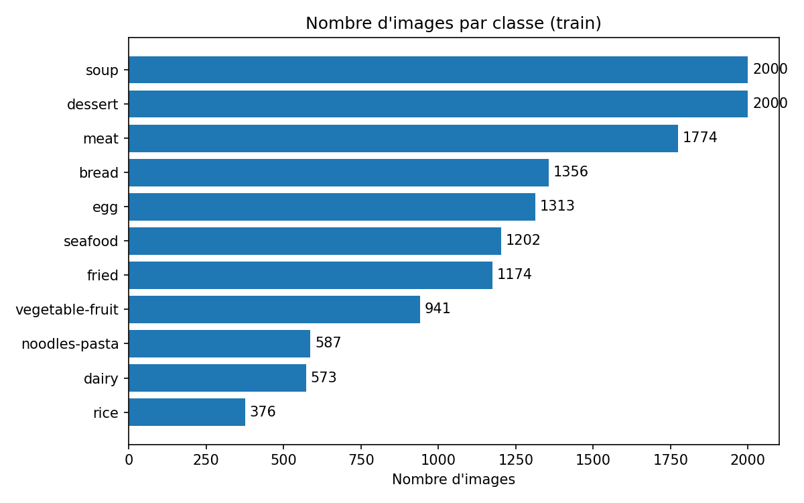
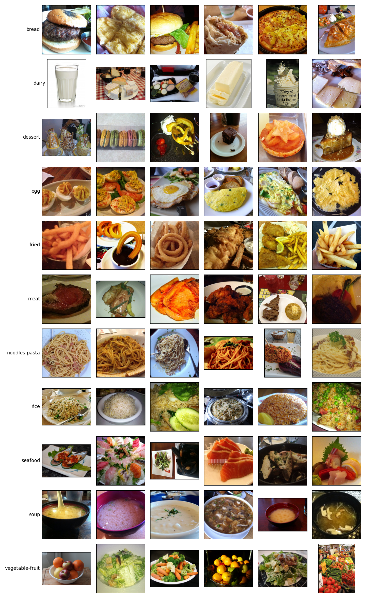

# Analyse du dataset Food-11

Maksim (tâches 1.2 et 1.4). Les figures et les chiffres viennent de :
`python data.py --plot-counts --samples --sizes --stats`

## Structure

- `data/food-11/train/` : 13 296 images, un dossier par classe
- `data/food-11/test/` : 3 097 images sans étiquette, de `0.jpg` à `3096.jpg`
- le dossier `data/` n'est pas sur Git
- 11 classes (ce sont aussi les noms à mettre dans le JSON) : bread, dairy, dessert, egg, fried, meat, noodles-pasta, rice, seafood, soup, vegetable-fruit

## Répartition des classes

Le dataset est déséquilibré : rice n'a que 376 images alors que dessert et soup en ont 2000 (on dirait que ces deux classes ont été plafonnées à 2000). Ça fait un rapport d'environ 5.

Comme le score du serveur est un F1 macro, chaque classe compte autant dans la note, même les petites. On a donc fait un split train / validation stratifié (80/20, seed 42) pour garder les mêmes proportions des deux côtés :

| Classe          |  Total |  Train | Validation |
| --------------- | -----: | -----: | ---------: |
| bread           |  1 356 |  1 085 |        271 |
| dairy           |    573 |    458 |        115 |
| dessert         |  2 000 |  1 600 |        400 |
| egg             |  1 313 |  1 050 |        263 |
| fried           |  1 174 |    939 |        235 |
| meat            |  1 774 |  1 419 |        355 |
| noodles-pasta   |    587 |    470 |        117 |
| rice            |    376 |    301 |         75 |
| seafood         |  1 202 |    961 |        241 |
| soup            |  2 000 |  1 600 |        400 |
| vegetable-fruit |    941 |    753 |        188 |
| Total           | 13 296 | 10 636 |      2 660 |

Rice n'a que 75 images en validation, donc son F1 risque de pas mal varier d'un entraînement à l'autre.

`data.py` enregistre le détail du split (quelle image est dans quel ensemble) dans `results/split_seed42.csv` ; avec la même graine, on retrouve exactement le même découpage.

## Tailles des images

|              | Min | Médiane |   Max |
| ------------ | --: | ------: | ----: |
| Largeur (px) | 220 |     512 | 9 216 |
| Hauteur (px) | 207 |     512 | 6 144 |

Il y a 695 tailles différentes, donc il faut tout ramener en 224×224 : `Resize` + `CenterCrop` pour la validation et le test, `RandomResizedCrop` pour le train. Les quelques images de moins de 224 px sont un peu agrandies.

Les très grosses images sont lentes à décoder. Dans `data.py` on utilise le mode draft de PIL, qui décode les JPEG directement en plus petit. En pratique ça change peu de choses : avec `--benchmark` on gagne seulement x1,2 à x1,4 sur 300 images prises au hasard. C'est parce que la réduction ne se fait que si l'image garde au moins 448 px de côté, et seules 142 images sur 13 296 sont assez grandes pour ça. Sur ces grandes images par contre, le chargement va à peu près 2 fois plus vite (1,8 s au lieu de 3,9 s pour 50 images).

## Normalisation

|                     |     R |     G |     B |
| ------------------- | ----: | ----: | ----: |
| Moyenne Food-11     | 0,570 | 0,451 | 0,327 |
| Moyenne ImageNet    | 0,485 | 0,456 | 0,406 |
| Écart-type Food-11  | 0,258 | 0,262 | 0,267 |
| Écart-type ImageNet | 0,229 | 0,224 | 0,225 |

Les photos de plats sont plus "chaudes" qu'ImageNet (plus de rouge, moins de bleu).

On a quand même gardé la normalisation ImageNet partout. Les réseaux pré-entraînés ont été entraînés avec ces valeurs, l'écart n'est pas énorme, et les BatchNorm s'adaptent pendant le fine-tuning. En plus, si tout le monde utilise la même normalisation, les comparaisons entre configurations restent justes.

## Ce qu'on remarque en regardant les images

Classes qui risquent d'être confondues (à vérifier avec la matrice de confusion, tâches 4.3 et 4.4) :
- meat et seafood : certains filets de saumon ressemblent beaucoup à de la viande
- fried, meat et seafood : poulet frit, poisson pané... le mode de cuisson et l'aliment se mélangent
- bread, meat et fried : bread contient des burgers, des pizzas et des wraps, souvent avec des frites
- dairy et dessert : crème, beurre, glaces
- egg, rice et bread : riz frit à l'œuf, œufs avec du pain

Normalement noodles-pasta et soup devraient être faciles, les images se ressemblent beaucoup.
Dairy et vegetable-fruit ont l'air plus difficiles. Dairy est petite et très variée (lait, fromage, beurre). Vegetable-fruit mélange des fruits, des salades et même des photos de marché.

Il y a aussi du bruit dans les étiquettes : beaucoup d'images ont plusieurs aliments pour une seule classe, et on a trouvé au moins une image hors sujet (un pot de crème pour le corps "body butter" rangé dans dairy).
